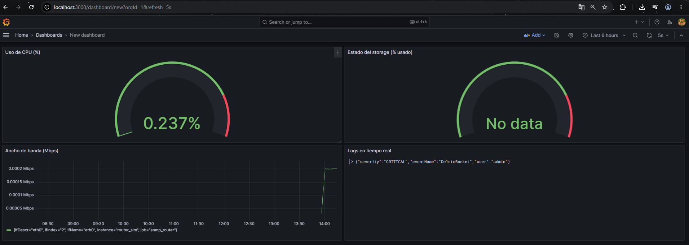
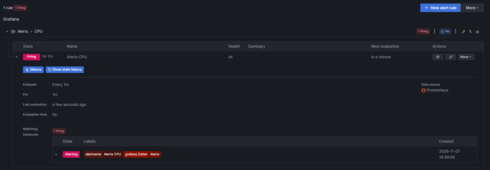
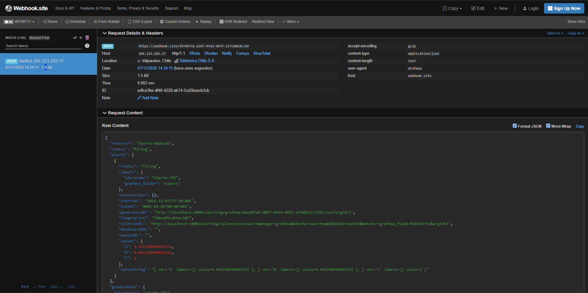
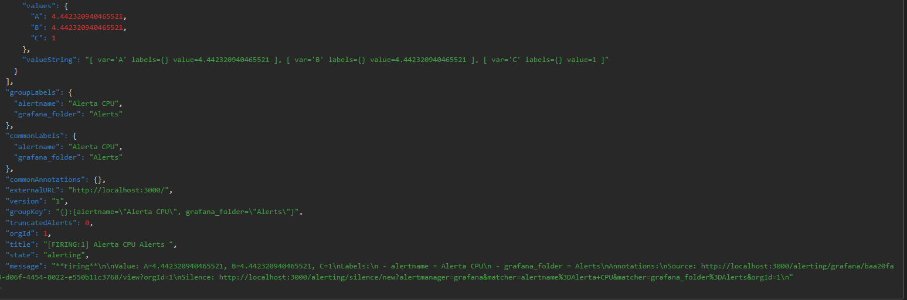
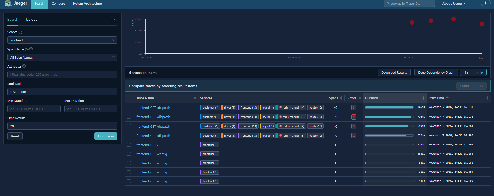
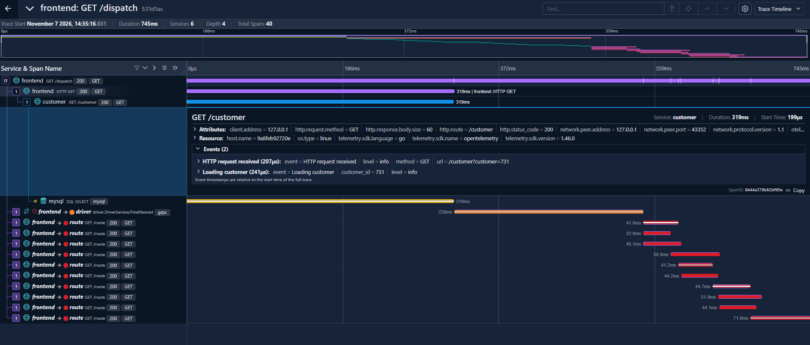

# Practica Final Integradora - Stack de Observabilidad Completo

**Taller Observabilidad Infraestructura con Stack Open Source - Universidad Andres Bello**
**Integrantes:** _(nombres)_  **Fecha:** _(entrega)_  **Repositorio:** _(URL)_

Todo el stack usa unicamente lo visto en los talleres de clases: Prometheus, Node Exporter, snmp_exporter con un agente net-snmp (`router_sim`), Loki, Promtail, Grafana, OpenTelemetry Collector, Jaeger y HotROD. Los dashboards y la alerta se arman desde la interfaz de Grafana, como en clases.

## 1. Paso a paso documentado

### 1.1 Levantar el entorno
Con Docker Desktop en ejecucion (`docker version` debe mostrar Client y Server):
```powershell
docker compose up -d --build
docker compose ps
```
La primera vez compila net-snmp (varios minutos). 📸 `capturas/01-compose-ps.png`

URLs: Prometheus http://localhost:9090 · Grafana http://localhost:3000 (admin/admin) · Jaeger http://localhost:16686 · HotROD http://localhost:8080

### 1.2 Bloque 1 - Metricas (Prometheus, Node Exporter, SNMP)
1. En http://localhost:9090/targets deben estar **UP** `node-exporter`, `snmp_router` y `prometheus`. 📸 `capturas/02-targets.png`
2. Consulta de **uso de CPU (%)**:
   ```promql
   100 - (avg by (instance) (rate(node_cpu_seconds_total{mode="idle"}[5m])) * 100)
   ```
   📸 `capturas/03-promql-cpu.png`
3. Consulta de **ancho de banda en Mbps** de la interfaz de red del agente SNMP:
   ```promql
   rate(ifHCInOctets{ifDescr="eth0"}[5m]) * 8 / 1000000
   ```
   Primero ejecuta `ifHCInOctets` para ver las etiquetas reales; si la interfaz no se llama `eth0`, ajusta el filtro. 📸 `capturas/04-promql-mbps.png`
4. Para que el trafico sea visible (por defecto solo hay el de las consultas SNMP), genera trafico hacia el agente desde un contenedor existente:
   ```powershell
   docker exec -d prometheus ping -s 60000 172.21.0.12
   ```
   Para detenerlo: `docker restart prometheus`.

### 1.3 Bloque 2 - Logs (Loki + Promtail)
1. Promtail lee `/var/log/*log` (job `varlogs`) y `cloud-logs/*.json` (job `aws_cloudtrail_sim`). Para el segundo aplica un pipeline JSON que extrae `severity` como etiqueta **`level`** y `eventName` como `action` (ver `promtail-config.yml`).
2. Para simular nuevos eventos en la nube, agrega lineas al archivo:
   ```powershell
   Add-Content .\cloud-logs\eventos.json '{"severity":"ERROR","eventName":"AccessDenied","user":"alice"}'
   Add-Content .\cloud-logs\eventos.json '{"severity":"INFO","eventName":"GetObject","user":"devops"}'
   Add-Content .\cloud-logs\eventos.json '{"severity":"WARNING","eventName":"ConsoleLoginFailed","user":"admin"}'
   ```
3. En Grafana -> Explore -> Loki, comprobar que existe la etiqueta `level` y consultar `{job="aws_cloudtrail_sim", level="ERROR"}`. 📸 `capturas/05-loki-level.png`

### 1.4 Bloque 3 - Grafana: datasources, dashboard y alerta
1. **Data sources** (Connections -> Data sources -> Add data source):
   - Prometheus: URL `http://prometheus:9090`
   - Loki: URL `http://loki:3100`
   Pulsar *Save & test* en cada uno. 📸 `capturas/06-datasources.png`
2. **Dashboard Operativo** (Dashboards -> New dashboard) con estos paneles:

   | Panel | Datasource | Visualizacion | Consulta |
   |---|---|---|---|
   | Ancho de banda (Mbps) | Prometheus | Time series | `rate(ifHCInOctets{ifDescr="eth0"}[5m]) * 8 / 1000000` |
   | Uso de CPU (%) | Prometheus | Time series | la consulta de CPU del punto 1.2 |
   | Estado del storage (% usado) | Prometheus | Gauge | `100 - (node_filesystem_avail_bytes{mountpoint="/"} / node_filesystem_size_bytes{mountpoint="/"} * 100)` |
   | Logs en tiempo real | Loki | Logs | `{job="aws_cloudtrail_sim"}` |

   Activa el refresco automatico (5 s) y guarda como **Dashboard Operativo**. 📸 `capturas/07-dashboard-operativo.png`
3. **Alerta de CPU** (Alerting -> Alert rules -> New alert rule):
   - Consulta A (Prometheus): `100 - (avg(rate(node_cpu_seconds_total{mode="idle"}[1m])) * 100)`
   - Condicion: umbral mayor a 80 (para la demostracion puedes bajarlo temporalmente, por ejemplo a 5)
   - Evaluar cada 1 minuto, *pending period* 1 minuto
   - Contact point de tipo **Webhook** con la URL de un receptor de pruebas (por ejemplo una URL generada en https://webhook.site)
   Para subir la CPU durante la prueba:
   ```powershell
   docker exec -d prometheus sh -c "while true; do :; done"
   ```
   Se detiene con `docker restart prometheus`. 📸 `capturas/08-alerta-firing.png` y `capturas/09-webhook-recibido.png`

### 1.5 Bloque 4 - Trazas (OpenTelemetry Collector + Jaeger + HotROD)
1. Abrir http://localhost:8080 y pulsar varios clientes para pedir viajes (cada clic genera una traza).
2. HotROD envia OTLP/HTTP a `otel-collector:4318`, que reenvia a Jaeger por OTLP gRPC (`otel-collector-config.yaml`).
3. En http://localhost:16686 elegir el servicio `frontend` -> *Find Traces*. 📸 `capturas/10-jaeger-lista.png`
4. Abrir una traza `/dispatch` y analizar el diagrama de Gantt. 📸 `capturas/11-jaeger-traza.png`

## 2. Justificacion tecnica
- **CPU**: `node_cpu_seconds_total` es un contador por nucleo y modo; `rate()` lo convierte en tasa, y medir el modo *idle* y restarlo de 100 evita sumar cada modo. `avg` consolida los nucleos.
- **Mbps**: se usa `ifHCInOctets` (64 bits) porque los contadores de 32 bits se desbordan rapido; el factor `* 8` pasa bytes a bits y `/ 1000000` a megabits.
- **snmp_exporter y `relabel_configs`**: el dispositivo objetivo viaja como parametro `target`, `instance` conserva el nombre real del agente y el scrape se redirige al exporter. Asi un solo exporter sirve para muchos equipos. El modulo `if_mib` es el estandar de interfaces de red.
- **Etiqueta `level`**: Loki indexa etiquetas y no el contenido; `level` y `action` tienen pocos valores distintos (baja cardinalidad), por lo que filtrar por severidad es rapido. Los demas campos del JSON (como `user`) no se indexan.
- **Dos jobs en Promtail**: uno para los logs del sistema operativo y otro para los logs de cloud con pipeline JSON.
- **Gauge de storage**: se muestra el porcentaje usado, comparable entre discos de distinto tamano.
- **Alerta**: el umbral y el periodo *pending* evitan falsos positivos por picos breves; el Webhook simula la notificacion a una herramienta externa.
- **OTel Collector entre la app y Jaeger**: desacopla la aplicacion del backend de trazas; HotROD solo conoce el endpoint OTLP y el Collector decide el destino. HotROD incluye latencias deliberadas que permiten buscar cuellos de botella.

## 3. Evidencia de funcionamiento







## 4. Conclusiones y lecciones aprendidas
_(Reescribir con tus palabras.)_
- Las metricas dicen **que** pasa, los logs **por que** y las trazas **donde**; Grafana permite verlos juntos.
- Un panel de errores y una alerta de CPU permiten detectar incidentes antes de que los reporte un usuario.
- Las etiquetas en Loki y Prometheus deben ser de baja cardinalidad.
- Los contadores solo tienen sentido con `rate()`.
- El Collector de OpenTelemetry hace portable la instrumentacion.
- Docker Compose permite reproducir todo el entorno con un comando.
- **Dificultades encontradas:** _(por ejemplo Docker Desktop apagado, compilacion de net-snmp, etc.)_
- **Mejoras posibles:** Alertmanager, provisioning de Grafana por archivos, retencion de logs, correlacion logs-trazas.